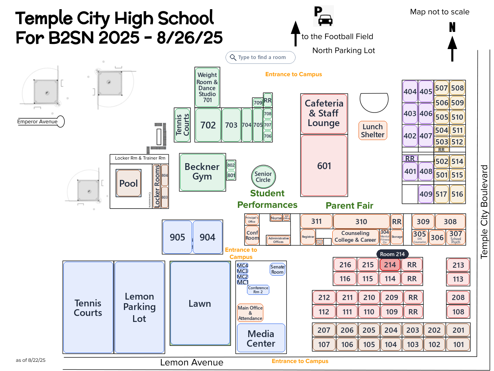
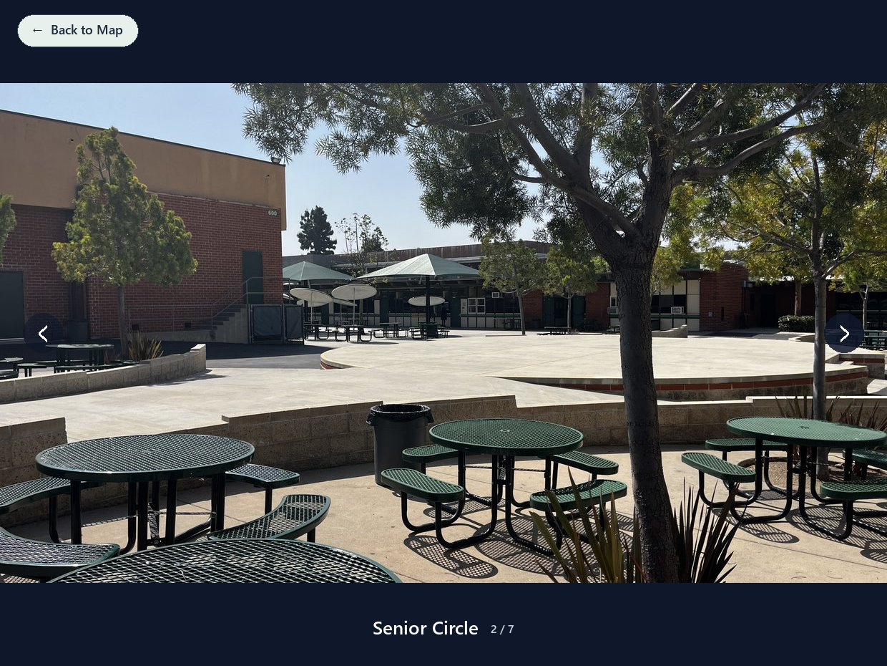

# TCHS Interactive Map

An interactive campus map of Temple City High School. Click any room or area on the map to see photos of it — handy for new students, visitors and Back to School Night.



## Features

- **The 2025 campus map** (as of 8/22/25), with every room and area clickable.
- **Search** — just start typing a room number or name (like `214` or `nurse`). Matching places light up; press Enter to open the first one.
- **Photo galleries** — places like the gym, Senior Circle and 601 have several photos. Browse them with the arrow buttons or the ← → keys.
- **Color-coded buildings** with hover highlights and a tooltip showing each place's full name.
- **Resizable and fullscreen** — maximize the window or press F11.



## Running it

You need [Python 3](https://www.python.org/downloads/) (3.9 or newer).

```bash
pip install -r requirements.txt
python main.py
```

## Controls

| Action | How |
| --- | --- |
| Open a place's photos | Click anywhere inside its box on the map |
| Find a room | Start typing on the map; **Enter** opens the first match, **Esc** clears |
| Next / previous photo | Arrow buttons, or **←** **→** |
| Go back to the map | **← Back to Map**, **Esc** or **Backspace** |
| Fullscreen on / off | **F11** (or maximize the window) |

## Adding or replacing photos

Every place on the map is one line in the `PLACES` list near the top of `main.py`:

```python
P('214', RED, (952, 646, 54, 34), ['214.jpg']),
```

That's the label, its color, its box on the map (x, y, width, height) and its photos. To add photos:

1. Put the photos in `assets/` (JPEG or PNG — any size or shape works).
2. Add their file names to the place's list, e.g. `['214.jpg', '214 inside.jpg']`.

Places without a list (like `P('212', RED, (784, 728, 59, 34))`) show a stand-in photo marked "real photo coming soon" until they get their own.

## Project layout

```
main.py              The app
assets/              Campus map and location photos (sized for the app)
TCHS Map 2025.pdf    The original campus map
docs/                Screenshots for this README
```
