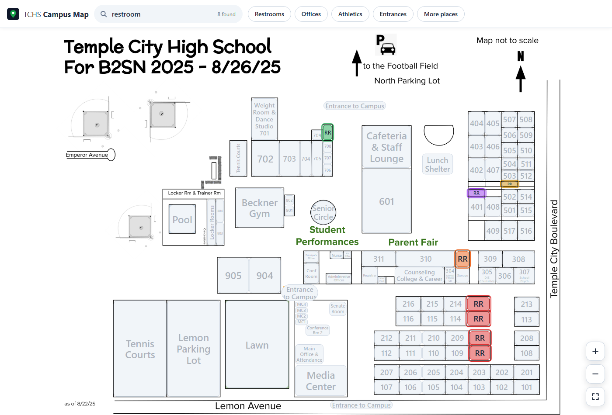
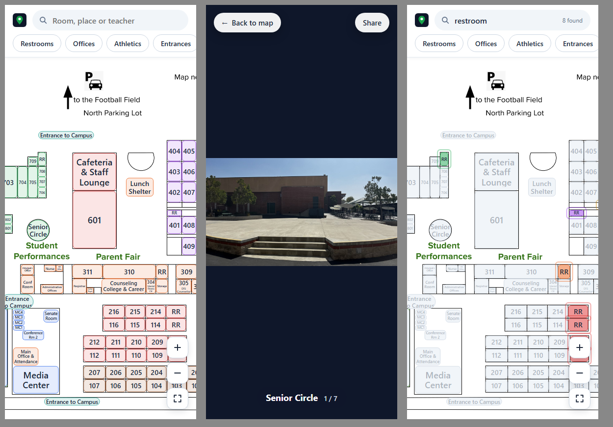

# TCHS Interactive Map

An interactive campus map of Temple City High School. Find any room, office or teacher and see photos of it — on a phone, in a browser, or on a computer in the front office.



## Three ways to use it

| | Best for | How |
| --- | --- | --- |
| **Website** | Parents and students on their phones | Open **https://tchs-interactive-map.vercel.app** or scan the QR code on the [printable poster](web/poster.html) |
| **Windows app** | School computers | Download **TCHS.Map.exe** from [Releases](../../releases) and double-click it — no Python needed |
| **Python** | Working on the project | `pip install -r requirements.txt`, then `python main.py` |

## Features

- **Search by room, place or teacher** — type `214`, `nurse` or a teacher's name. Matches light up on the map.
- **Quick find** — one tap highlights every restroom, office, athletics area or campus entrance.
- **Photo galleries** — swipe, click the arrows or use ← → to browse a place's photos.
- **Zoom and pan** — pinch, scroll or use the + / − buttons; drag to move around.
- **More places** — photos of spots that aren't outlined on the map, like the basketball courts and Team Room.
- **Shareable links** — every place has its own link (for example `…/#214`), handy for emails or room-specific QR codes.
- **Kiosk mode** for a screen at an event — fullscreen, a big "tap a room" prompt, and it resets itself after a minute without use. Website: add `?kiosk` to the address. Windows/Python: run with `--kiosk`.

<p align="center"></p>

## Keeping it up to date

Everything that changes from year to year lives in two folders, so most updates don't need any code.

### Teachers and subjects — `data/rooms.csv`

Open `data/rooms.csv` in Excel or Google Sheets and fill in the **teacher** and **subject** columns (and **notes** if useful). Leave the **id** column as it is. Searching for a teacher's name will then find their room, and the room's photo caption shows who teaches there.

### Photos — `assets/photos/<place>/`

Each place has its own folder, like `assets/photos/214/`. To add or replace photos:

1. Put the photos in that place's folder (JPEG or PNG, any size — they're shown fitted to the screen). Photos are shown in file-name order.
2. Run `python tools/build.py`. It updates the website's photo list and **[PHOTO-CHECKLIST.md](PHOTO-CHECKLIST.md)** — a printable list of every place still waiting for a photo.

Places without photos show a stand-in photo marked "real photo coming soon".

### Rooms on the map — `data/places.json`

Each place's label, color, type and box on the map (x, y, width, height on the 1240 × 930 map) are listed here. Places in `"extras"` have photos but no box, and appear under **More places**.

## Publishing

- **Website:** hosted on Vercel at https://tchs-interactive-map.vercel.app (project `tchs-interactive-map`). The GitHub repo is connected, so every push to `main` updates the site automatically within a minute or so. `vercel.json` publishes only the website files (`index.html`, `web/`, `data/`, `assets/`).
- **Try the website locally:** run `python -m http.server` in this folder and open http://localhost:8000.
- **Windows app:** push a version tag, e.g. `git tag v1.1.0 && git push origin v1.1.0`. GitHub builds `TCHS Map.exe` and attaches it to a new release (`.github/workflows/windows-app.yml`).

## Project layout

```
index.html, web/        The website
main.py                 The Python / Windows app
data/places.json        Every place on the map
data/rooms.csv          Teachers and subjects (edit in a spreadsheet)
data/photos.json        Photo list for the website (made by tools/build.py)
assets/photos/<place>/  Photos, one folder per place
assets/map_2025_hd.png  The campus map
tools/build.py          Refreshes the photo list and the photo checklist
TCHS Map 2025.pdf       The original campus map
```
